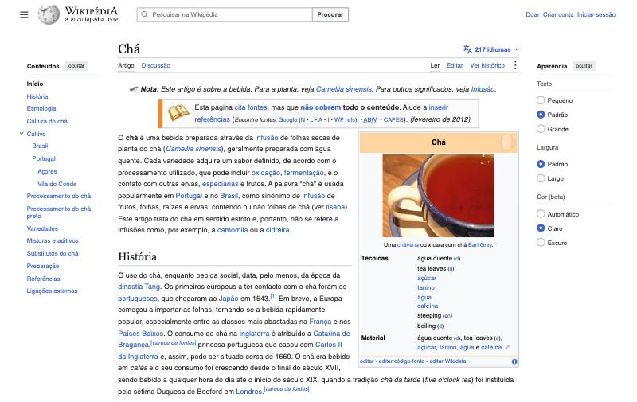
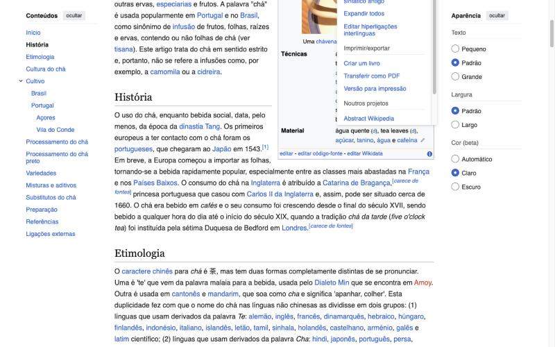
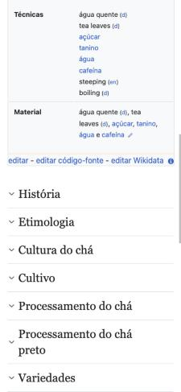
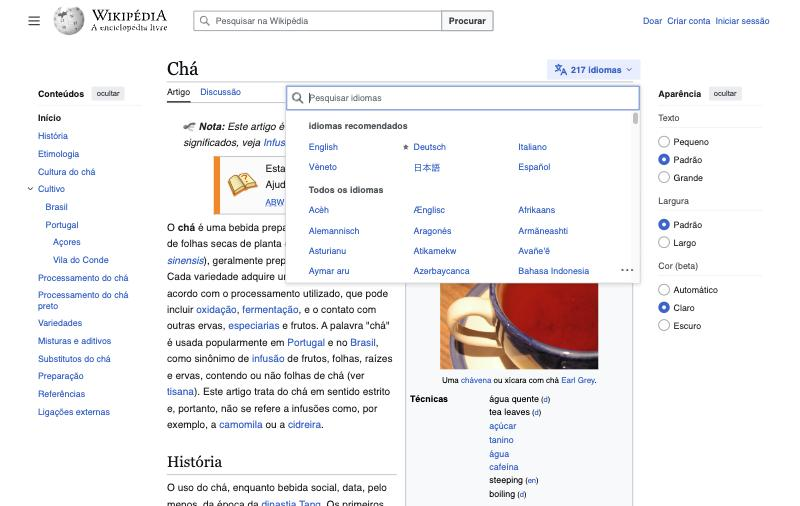

# 1. Auditoria do artigo atual

Data da auditoria: 15 de outubro de 2026. Revisão analisada: [73198638](https://pt.wikipedia.org/w/index.php?title=Ch%C3%A1&oldid=73198638), de 13 de outubro de 2026.

Abri o artigo "Chá" sem estar logado, que é como a maioria das pessoas lê a Wikipédia. No computador a página usa o Vector 2022; no celular, o Minerva (pt.m.wikipedia.org). Medi as duas versões no navegador em três tamanhos de tela: 1440×900, 1280×800 e 375×812. Para os números de leitura escrevi um script que percorre cada parágrafo caractere por caractere e agrupa os caracteres pela linha em que caem na tela. Assim dá para saber quantos caracteres cabem de fato em cada linha, em vez de estimar pela largura da coluna.

## O artigo em números

Antes de olhar a interface, quis entender o conteúdo, porque é ele que o redesign tem que acomodar.

| Item | Valor |
| --- | --- |
| Palavras | cerca de 3.200: 2.400 em parágrafos e o resto em listas e legendas |
| Títulos | 12 seções principais, 2 subseções (Brasil, Portugal) e 2 subsubseções (Açores, Vila do Conde) |
| Seções mais longas | Cultura do chá (471 palavras) e Preparação (468) |
| Seção mais curta | Substitutos do chá: uma frase de 16 palavras e uma lista de 5 itens |
| Seção sem texto próprio | Portugal, que só agrupa Açores e Vila do Conde |
| Referências | 10 fontes, citadas 12 vezes; a fonte 6 aparece 3 vezes e as fontes 9 e 10 são a mesma publicação duplicada |
| Marcações "carece de fontes" | 2, ambas na seção História |
| Avisos de manutenção | 3: falta de fontes (desde fevereiro de 2012), perspectiva lusófona (dentro de Cultivo) e ligações para páginas de desambiguação (no fim) |
| Infobox | Predefinição Info/Bebida/Wikidata, com uma imagem e duas linhas de dados |
| Figuras | 4, além da imagem da infobox |
| Links no corpo | 306 internos, 43 externos, 12 para artigos que ainda não existem (links vermelhos) |
| Idiomas | 217 |
| Histórico | 531 edições desde 9 de junho de 2004, 289 pessoas (177 contas e 112 IPs) |
| Audiência | 6.167 visitas nos últimos 60 dias, cerca de 100 por dia |
| Discussão | 2 tópicos: "perquisem gorreana" e "Destacar ou não?" |

O artigo é médio para os padrões da Wikipédia. A versão em inglês, "Tea", tem 3,6 vezes o tamanho do código-fonte. Isso pesou nas decisões: o desenho tem que funcionar bem para um artigo de 3.200 palavras, mas não pode depender de ele ser curto. O sumário, a busca e as referências foram pensados para artigos com dezenas de seções e centenas de referências, mesmo que o protótipo só mostre o Chá (ver [10-limitacoes.md](10-limitacoes.md)).

Dois detalhes do conteúdo vão aparecer de novo ao longo do projeto. A infobox puxa dados do Wikidata e três valores vêm sem tradução: "tea leaves", "steeping" e "boiling". As linhas "Técnicas" e "Material" repetem a mesma lista de itens. E o histórico recente mostra duas edições de vandalismo desfeitas: uma em 38 segundos (13 de outubro) e outra em 29 minutos (6 de outubro). Nenhum desses problemas é de interface, e o redesign não corrige conteúdo. Mas eles mostram o tipo de informação que um leitor desconfiado gostaria de ver e hoje não vê.

## O que o Vector 2022 resolveu

O Vector 2022 consertou problemas reais da versão anterior e quero partir deles, não refazê-los.

O índice saiu do topo do artigo e virou uma coluna fixa à esquerda, chamada "Conteúdos", que acompanha a rolagem e marca a seção atual. No Vector antigo o índice era uma caixa que sumia assim que o leitor passava do primeiro parágrafo.

A largura do conteúdo ganhou um limite. Em monitores grandes o texto não se espalha mais pela tela toda.

O cabeçalho fica fixo ao rolar e mostra o título, a busca e as abas principais.

O seletor de idiomas foi para o lado do título ("217 idiomas"). Antes era uma lista longa no fim da barra lateral, fora da vista.

O painel "Aparência" permite escolher o tamanho do texto (pequeno, padrão, grande), a largura (padrão, largo) e a cor (automático, claro, escuro). A cor ainda aparece como "beta" na pt.wikipedia.

Já existem prévias de referências e de páginas ao passar o mouse sobre um link.

## O que ainda não resolveu

### A largura da linha muda dentro do mesmo artigo

A 1440 px, o parágrafo ocupa 897 px. Corpo em 16 px, fonte `sans-serif` genérica (no Mac vira Helvetica, no Windows Arial), entrelinha de 26 px. O problema é que a infobox flutua à direita do texto. Enquanto ela está ao lado, as linhas têm entre 64 e 69 caracteres. Quando ela acaba, as linhas saltam para 118 a 121 caracteres. Isso acontece no meio da seção História, no meio de um parágrafo.

A faixa confortável para texto corrido fica entre 45 e 75 caracteres, com 66 como referência clássica (Bringhurst, *Elementos do estilo tipográfico*). Linhas de 120 caracteres fazem o olho errar a volta para o começo da linha seguinte. Com a opção "Largo" ativada, fica pior.

O limite de largura do Vector 2022 resolveu a tela inteira, mas não a coluna de texto. A causa está no modelo de layout: imagens e infobox flutuam dentro da coluna e o texto contorna. Qualquer elemento flutuante muda a medida da linha.

### O primeiro parágrafo que se lê é um aviso para editores

No computador, antes da primeira frase do artigo aparecem a nota de desambiguação e a caixa "Esta página cita fontes, mas que não cobrem todo o conteúdo", com uma fileira de atalhos de busca (Google, N, L, A, I, WP refs, ABW, CAPES). Esses atalhos servem para quem vai editar. O aviso em si interessa ao leitor, porque diz quanto confiar no texto, mas a forma ocupa a primeira tela inteira junto com a infobox.

No celular o Minerva resolve isso melhor: mostra só "Esta página cita fontes, mas que não cobrem todo o conteúdo. (fevereiro de 2012)" em uma linha.

### No celular, as seções começam fechadas e não há sumário

O Minerva mostra o primeiro parágrafo, a infobox e depois uma lista de títulos recolhidos. A página inteira tem 2.899 px de altura nesse estado. Funciona como um sumário improvisado, mas tem custos.

As subseções somem. Brasil, Portugal, Açores e Vila do Conde só aparecem depois de abrir Cultivo. Quem procura "chá nos Açores" não tem como saber que existe uma seção sobre isso sem abrir as outras.

Depois de abrir três ou quatro seções, o leitor perde a noção de onde está. Não há indicação da seção atual ao rolar e não há sumário visível.

### Ferramentas do leitor misturadas com ferramentas do editor

"Citar esta página" está dentro do menu "Ferramentas" (o botão ⋮), junto com outros 17 itens. A maioria é para editores: Páginas afluentes, Alterações relacionadas, Enviar ficheiro, Mudar para o analisador sintático antigo, Editar hiperligações interlínguas, Criar um livro.

A página de citação em si tem problemas que um estudante vai copiar sem perceber. A data de acesso aparece igual à data da revisão (13 de outubro), não ao dia em que a pessoa consultou (15 de outubro). O estilo APA mistura inglês e português: "Retrieved 12:12, outubro 13, 2026". O BibTeX traz "accessed 13-outubro-2026". Os estilos ABNT e NP 405 estão lá, e são os mais úteis para quem lê em português.

### Histórico e discussão são só links

"Ver histórico" abre uma página feita para editores: lista de diferenças, bytes, caixas de seleção para comparar versões. Um leitor que quer saber se o artigo é estável, quem escreveu e se foi vandalizado recentemente precisa interpretar essa tabela. No caso do Chá, as quatro últimas edições são dois pares de vandalismo e reversão. A informação "o vandalismo foi desfeito em 38 segundos" é um bom sinal de confiança e está escondida.

"Discussão" é uma aba sem nenhuma indicação do que há lá. A página de discussão do Chá tem um tópico chamado "Destacar ou não?", que é exatamente o tipo de conversa sobre qualidade que interessa a um leitor crítico.

### Idiomas: muitos, sem critério para escolher

O seletor tem busca e uma área de "idiomas recomendados" no topo. Nesta sessão os recomendados foram English, Deutsch, Italiano, Vêneto, 日本語 e Español. Os 217 idiomas aparecem em três colunas ordenadas pelo nome nativo.

O seletor não ajuda a escolher entre versões. As edições alemã, lituana e ucraniana têm o selo de "artigo bom" e a macedônia é "artigo destacado". Isso aparece como uma estrela minúscula ao lado de "Deutsch", sem legenda. Nada indica que uma versão é muito mais completa que outra. Para quem lê mais de um idioma e está pesquisando, isso faz diferença.

### Referências: prévia só com mouse e salto para o fim

No computador, passar o mouse sobre "[1]" mostra uma prévia depois de um pequeno atraso. Clicar leva até a lista de referências no fim da página, e o caminho de volta é a seta "↑" ao lado de cada item. Com teclado, a prévia aparece ao focar o link, mas o comportamento depende do tempo de espera. Em telas de toque, o Minerva abre uma gaveta com a referência, o que funciona bem.

A fonte 6 é citada três vezes. Na lista, os links de volta aparecem como "1 2 3", sem dizer onde cada citação está.

### Não há como voltar onde parei nem buscar dentro do artigo

Nenhuma das duas versões lembra onde a leitura parou. A busca dentro do artigo depende do Ctrl+F do navegador, que não sabe em que seção está cada resultado e, no celular, fica escondido no menu do navegador.

### Links

São 306 links internos em 2.400 palavras, um a cada oito palavras. O azul do Vector (#3366cc) tem contraste de 5,37:1 com o fundo e 3,01:1 com o texto (#202122). Passa no mínimo de 3:1 que a WCAG pede quando a cor é o que distingue um link do texto, mas por pouco. Os 12 links vermelhos (#d73333) têm 4,76:1 com o fundo.

## Desempenho medido

| | Computador (Vector 2022) | Celular (Minerva) |
| --- | --- | --- |
| HTML comprimido | 54 KB | 47 KB |
| HTML descomprimido | 268 KB | não medido |
| Demais recursos (comprimidos) | cerca de 178 KB: 82 KB de imagens, 60 KB de JavaScript, 36 KB de CSS | cerca de 405 KB |
| Requisições | 37 | 30 |

Medido com a Resource Timing API do navegador. Os valores são aproximados porque alguns recursos vieram do cache.

A página atual já é leve. Isso define a barra para o redesign: ele não pode ser mais pesado que isso, e o texto precisa aparecer antes de qualquer JavaScript rodar.

## Resumo dos problemas

Numerei os problemas para citar nos outros documentos.

- P1. A medida da linha varia de 64 a 121 caracteres no mesmo artigo por causa de elementos flutuantes.
- P2. A primeira tela é ocupada por avisos para editores e pela infobox antes do texto.
- P3. No celular, as seções recolhidas escondem subseções e não existe sumário nem indicação de posição.
- P4. Citar, histórico e discussão estão escondidos ou levam a páginas feitas para editores.
- P5. O seletor de idiomas não ajuda a escolher entre versões.
- P6. Consultar uma referência tira o leitor do lugar, exceto no celular.
- P7. Não há como retomar a leitura nem buscar com noção da estrutura do artigo.
- P8. A infobox é uma ilha: não leva o leitor ao trecho do texto que trata de cada dado.
