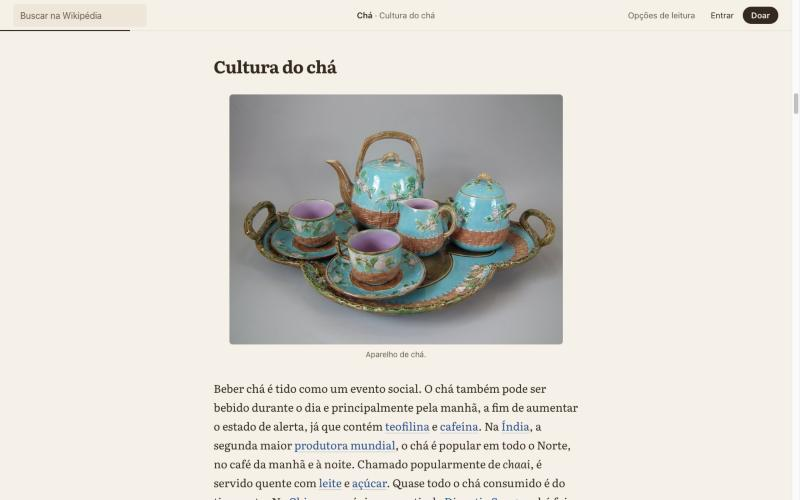

# 4. Tipografia e layout

## A medida da linha

O problema P1 da auditoria (linhas de 64 a 121 caracteres no mesmo artigo) decidiu a regra mais importante do projeto: a coluna de texto tem largura fixa e nada flutua dentro dela.

A largura é definida em `ch`, a unidade que acompanha a largura dos caracteres da fonte em uso. Comecei com 62ch e medi no navegador, com o mesmo script da auditoria, quantos caracteres cabiam por linha nos 21 parágrafos longos do artigo. Deu 73, acima do que eu queria. Ajustei as três opções até chegar nestes números:

| Opção | Valor | Caracteres por linha (média) | Faixa medida |
| --- | --- | --- | --- |
| Estreita | 47ch | 55 | 52 a 59 |
| Média (padrão) | 55ch | 65 | 61 a 68 |
| Larga | 64ch | 76 | 66 a 80 |

A variação dentro de cada opção vem das palavras longas que não cabem no fim da linha, não do layout. Compare com 64 a 121 na página atual.

O `ch` não resolve tudo. A unidade é a largura do algarismo "0" da fonte, e a proporção entre o "0" e as outras letras muda de uma família para outra. Medi cada fonte com o mesmo valor e depois ajustei um fator de correção por família:

| Fonte | Fator | Caracteres por linha |
| --- | --- | --- |
| Serifada | 1,0 | 65 |
| Sem serifa | 0,9 | 66 |
| Inter | 0,96 | 65 |
| Literata | 1,03 | 65 |
| Source Serif | 1,14 | 66 |
| Legibilidade | 0,94 | 66 |

Na primeira calibração, só com três fontes, a Atkinson parecia precisar de 1,08. Era um erro de medição: o teste rodou antes de a fonte carregar e mediu a fonte de reserva. Com a fonte carregada, o fator certo é 0,94. A medição agora espera `document.fonts.load` antes de contar.

No celular a coluna ocupa a tela, com 16 px de margem de cada lado. A 375 px de largura ficam 39 caracteres por linha (medido na versão 2). É menos que o ideal para computador, mas é o que cabe com um corpo de 18 px, e reduzir o corpo para ganhar caracteres seria pior.

## Família tipográfica

> Atualização da versão 2: o padrão voltou a ser a serifada do sistema (Charter). A tabela e o texto abaixo foram atualizados; a seção sobre o padrão registra as duas mudanças.

Seis opções para o texto do artigo. A interface (barras, botões, painéis, ficha, referências) fica sempre na fonte sans do sistema, exceto na opção Legibilidade. Assim o leitor distingue o que é conteúdo do que é ferramenta, e escolher uma fonte de leitura não muda o resto da página.

| Opção | Fonte | Peso extra | Caráter |
| --- | --- | --- | --- |
| Serifada (padrão) | Charter no Mac e iOS, Sitka Text no Windows, Noto Serif no Android | 0 | Texto de revista e de livro, com a fonte que o sistema já tem |
| Sem serifa | San Francisco no Mac e iOS, Segoe UI Variable no Windows, Roboto no Android | 0 | A aparência do Notion e dos apps da Apple |
| Inter | Inter, de Rasmus Andersson | 48 KB | Sans neutra e nítida, a fonte do Linear |
| Literata | Literata, da TypeTogether para o Google Play Livros | 79 KB | Serifada desenhada para leitura longa em tela |
| Source Serif | Source Serif 4, da Adobe | 103 KB | Serifada de transição, mais seca e clara |
| Legibilidade | Atkinson Hyperlegible Next, do Braille Institute | 48 KB | Letras que não se confundem, com mais espaço entre letras e palavras |

Todas as fontes baixadas são variáveis, só do alfabeto latino (cobre o português) e só carregam quando escolhidas, porque o `@font-face` de uma fonte só é buscado quando algum elemento a usa. O padrão não baixa nada.

### O padrão mudou duas vezes

A primeira versão usava Charter. No acabamento Notion e Linear (versão 1 final), troquei para a sans do sistema, porque essas referências são interfaces sans de ponta a ponta. Na versão 2 a referência passou a ser Medium e Substack, que são de leitura longa e usam serifa no texto, e o padrão voltou a ser Charter. As duas continuam a um clique. O orçamento de peso não muda com a escolha: nenhuma das duas baixa um byte de fonte na primeira visita.

### Opções que testei e tirei

Newsreader, com o eixo de tamanho óptico, ficou com 279 KB entre romano e itálico. Só com o eixo de peso, 123 KB, mais que o dobro das outras serifadas, e sem o eixo óptico ela perde o desenho que a justifica. Lora entrou na lista e saiu: ficou parecida demais com Literata e Source Serif para valer uma quarta serifada. As fontes com eixo de tamanho óptico em Inter e Literata passaram de 73 KB e 110 KB cada, então pedi só o eixo de peso.

Descartei OpenDyslexic pelos motivos já descritos: os estudos não encontram ganho de leitura (Wery e Diliberto, 2017, com OpenDyslexic; Kuster e colegas, 2018, com a Dyslexie). O que tem mais evidência a favor é aumentar o espaço entre letras (Zorzi e colegas, 2012). O nome da opção é "Legibilidade" porque ela também ajuda quem tem baixa visão e porque não quero prometer um efeito que a pesquisa não confirma.

A fonte do sistema no Windows e no Linux depende do que está instalado. O pior caso é Arial ou Helvetica, que são aceitáveis e já foram a fonte da Wikipédia.

## Escala e hierarquia

O corpo do texto tem 18 px no celular e 20 px a partir de 768 px, sempre em `rem`, para respeitar o tamanho de fonte que o leitor escolheu no navegador. As opções de tamanho multiplicam esse valor (90%, 100%, 112%, 125% e 142%).

| Elemento | Tamanho | Peso | Espaço |
| --- | --- | --- | --- |
| Título do artigo | 44 a 72 px, conforme a largura | negrito, espaçamento -0,025em | |
| Seção (h2) | 1,55 vez o corpo | negrito (semibold nas sans) | 2,3 linhas acima, 0,5 abaixo |
| Subseção (h3) | 1,2 vez o corpo | negrito (semibold nas sans) | 1,8 acima, 0,45 abaixo |
| Subsubseção (h4) | igual ao corpo | negrito (semibold nas sans) | 1,6 acima, 0,4 abaixo |
| Corpo | 18 ou 20 px | regular | 0,9 linha entre parágrafos |
| Interface | 15 px | regular | |
| Legendas, ficha, notas | 14 px | regular | |

Os títulos são em negrito com espaçamento levemente negativo. Na primeira versão, com serifada, eram em peso regular; no formato de publicação, o título é a âncora visual da página e precisa de peso. O espaço acima de cada título é sempre maior que o espaço abaixo, para o título ficar visualmente preso ao texto que ele abre.

Nenhum texto tem menos de 14 px, com uma exceção: os números das chamadas de referência, que são sobrescritos por convenção. Para compensar, a área clicável de cada chamada é maior que o número (ver [07-acessibilidade.md](07-acessibilidade.md)).

A entrelinha padrão é 1,7, com opções de 1,5 e 1,9. O texto é alinhado à esquerda, sem justificação e sem hifenização automática. Justificar cria espaços irregulares entre palavras, e a hifenização atrapalha quem tem dislexia; com o texto alinhado à esquerda nenhuma das duas é necessária. Uso `text-wrap: pretty` nos parágrafos, para evitar palavras sozinhas na última linha, e `text-wrap: balance` nos títulos.

No corpo, os números usam algarismos de texto quando a fonte oferece, para datas como 1543 e 1660 não saltarem da linha. Na ficha, nas tabelas e na linha de metadados os números são alinhados e de largura fixa.

## A grade

Os pontos de quebra são em `em`, não em pixels. Se o leitor aumentar a fonte padrão do navegador, a página passa para o layout de tela menor no momento certo, em vez de espremer a coluna.

Na versão 2 há uma coluna única centralizada em todas as larguras. A única coisa que muda é a barra de navegação.

| Largura | Barra de navegação |
| --- | --- |
| Até 48em (768 px) | Barra do topo com a marca e a busca, rolando com a página. Barra inferior fixa com a seção atual e as opções de leitura |
| A partir de 48em | Barra do topo fixa, em três zonas: busca, marca (que vira título e seção atual depois do título) e opções, entrar e doar. Linha de progresso embaixo |

A coluna tem `55ch` vezes o fator da fonte, em caracteres do próprio texto (ver acima), o que dá de 610 a 665 px com o corpo de 20 px. A imagem de abertura usa 135% da coluna, limitada pela tela. As figuras do texto ocupam a coluna, centralizadas, e nunca passam da largura do arquivo da Wikimedia, para não ampliar uma foto de 435 px até ficar borrada. A ficha é um bloco com fundo cinza, na coluna.

Na versão 1 havia três colunas (sumário, texto e margem para a ficha e as figuras). Ela está descrita em [11-versao-2-editorial.md](11-versao-2-editorial.md) e no código da tag `v1-notion`.

A ficha é a única peça que muda de lugar no HTML. No wikitexto ela vem antes do primeiro parágrafo por convenção de edição. Mantida ali, a primeira tela seria a ficha inteira, com o texto começando abaixo da dobra (problema P2). Movi a ficha para depois do primeiro parágrafo da introdução, que é o que o Minerva já faz no celular. É uma exceção consciente ao princípio 1 e está registrada em [D08](registro-de-decisoes.md#d08-mover-a-ficha-para-depois-do-primeiro-parágrafo).

## O que o build faz com o HTML do artigo

`scripts/transform.mjs` recebe o HTML do Parsoid e devolve o HTML do artigo. Nenhuma palavra do artigo é alterada. A lista abaixo é completa.

1. Remove os `<style>` das predefinições, os `<link>` de categoria e os marcadores vazios. As categorias visíveis vêm da API e aparecem no rodapé.
2. Remove uma lista escondida (`#interProject`) que o Vector usa para montar a barra lateral. O mesmo conteúdo está visível na caixa "Outros projetos" da seção Ligações externas.
3. Remove 5 ícones decorativos: os três dos avisos de manutenção, o da nota de desambiguação e o atalho para a documentação da predefinição da ficha.
4. Reescreve links internos para apontar para a pt.wikipedia.org. Marca links vermelhos e externos com classes, sem mudar o texto.
5. Troca endereços de imagem relativos por absolutos, tira os parâmetros de rastreamento `utm_*` e gera um `srcset` com as larguras padronizadas da Wikimedia (330 e 500 px). Links de imagem sem texto alternativo recebem um nome acessível com o nome do arquivo; o `alt` continua como os editores deixaram.
6. Converte os avisos de manutenção de tabela de layout para nota (`role="note"`), com o mesmo texto. A parte "Ajude a inserir referências" fica em cor secundária.
7. Converte a nota de desambiguação em parágrafo com `role="note"`.
8. Converte a ficha em `<aside>` com rótulo, tira os estilos inline (como o fundo laranja do título) e a move para depois do primeiro parágrafo.
9. Converte as caixas de navegação e o controle de autoridade em `
`, fechados como no original. Funcionam sem JavaScript.
10. Tira o estilo inline das predefinições, preservando `white-space: nowrap` (que evita quebrar "século XVII").
11. Envolve tabelas de dados num contêiner com rolagem horizontal acessível por teclado. O Chá não tem tabelas de dados, mas a regra fica para outros artigos.
12. Liga cada seção ao seu título (`aria-labelledby`) e conta as palavras por seção.
13. Troca as setas "↑" das referências por "Citada em" e o nome da seção. A fonte 6, citada três vezes em Variedades, mostra "Citada em Variedades (1, 2, 3)", e cada número volta ao ponto da citação.
14. Remove os atributos internos do Parsoid (`data-mw`, `about`, `typeof` e os ids `mwXX` que ninguém usa).

O HTML do Parsoid tem 121 KB. A página final, com toda a interface, tem 98 KB, ou 24,6 KB comprimida.
