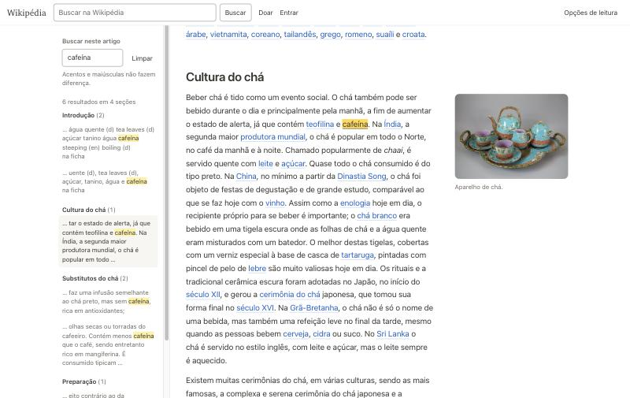
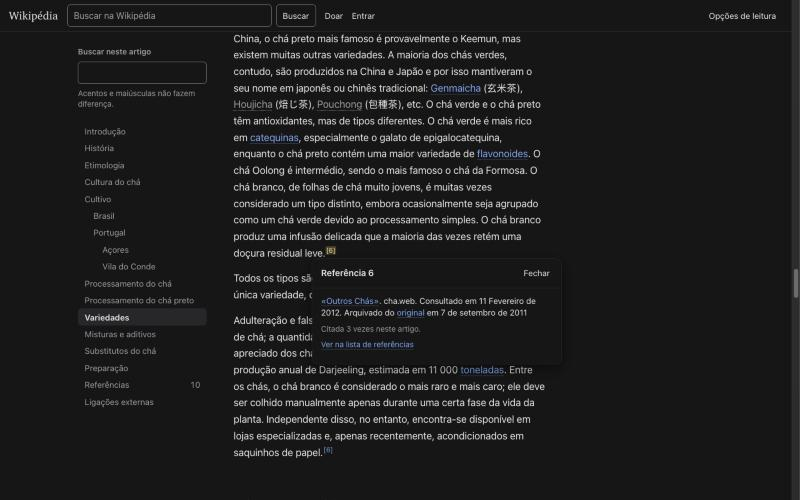
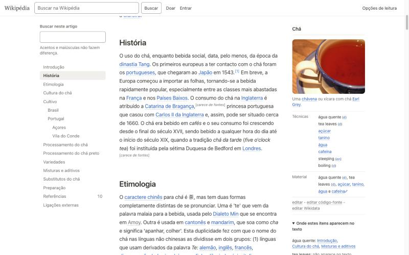
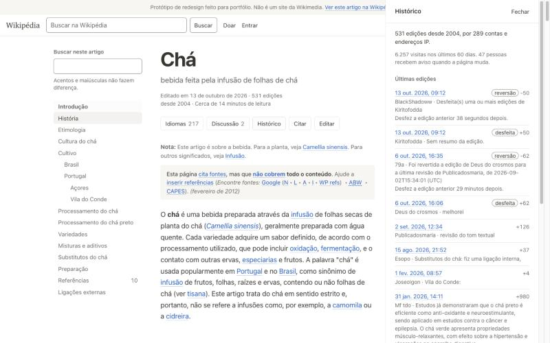
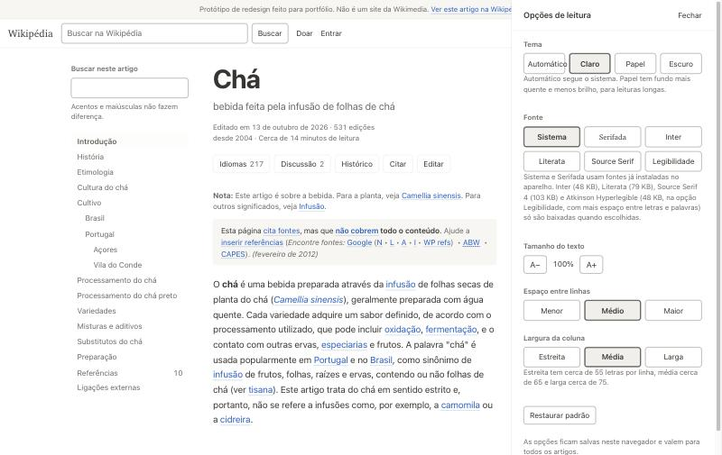
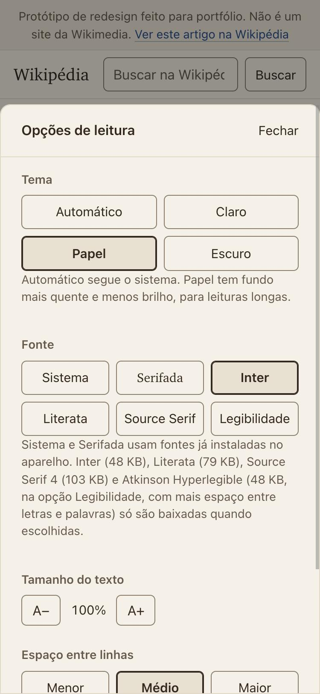

# 6. Funcionalidades

Cada funcionalidade responde a um problema da [auditoria](01-auditoria.md). Para cada uma: o problema, as alternativas, o que escolhi, por quê e o que descartei. Todas funcionam com teclado e têm um caminho sem JavaScript, descrito no fim de cada seção.

## Seções e posição atual

Problema (P3). O leitor não sabe em que parte do artigo está, principalmente no celular, onde não existe sumário.

Alternativas. Barra de progresso com porcentagem no topo da página. Sumário só no topo do artigo, como no Vector antigo. Seções recolhidas, como no Minerva. Um elemento fixo que mostra a seção atual e abre o sumário.

Escolha. Um elemento fixo em todas as larguras. No computador é o próprio sumário lateral, com a seção atual em negrito e uma barra à esquerda. No tablet é a barra do topo, que mostra o caminho ("Cultivo › Portugal › Açores"). No celular é a barra inferior, com o rótulo "Seções" e o caminho. Tocar no caminho abre o sumário completo.

Por quê. A porcentagem diz quanto falta, mas não diz onde o leitor está. "Açores" diz as duas coisas, porque o sumário mostra o que vem antes e depois. O caminho completo importa no Chá porque "Açores" e "Vila do Conde" só fazem sentido dentro de "Portugal".

A seção atual é a do último título que passou de um quarto da altura da tela. Com a metade da tela como referência, a troca aconteceria tarde: o leitor já estaria nas primeiras linhas da seção nova e a barra ainda mostraria a anterior.

Descartado. Mostrar o tempo de leitura de cada seção no sumário. Ajudaria a decidir o que ler, mas acrescenta um número a cada linha e o sumário deixa de ser escaneável.

Sem JavaScript. O sumário aparece como lista de links no topo da página, como um índice de livro.

## Busca no artigo

Problema (P7). Ctrl+F não sabe em que seção está cada resultado e, no celular, fica escondido no menu do navegador.

Alternativas. Interceptar o Ctrl+F do navegador. Um campo de busca separado que lista os resultados. Um campo que filtra o próprio sumário.

Escolha. Um campo "Buscar neste artigo" em cima do sumário. Ao digitar, a lista de seções dá lugar aos resultados agrupados pela seção onde aparecem, com o caminho completo e o número de ocorrências. Cada resultado mostra o trecho ao redor da palavra. No texto, todas as ocorrências ficam marcadas em amarelo e a atual em amarelo mais forte.

Por quê. Buscar e navegar respondem à mesma pergunta, então moram no mesmo lugar e usam a mesma estrutura. Procurar "cafeína" devolve "6 resultados em 4 seções" e o leitor vê de cara que o assunto aparece na Introdução (dentro da ficha), em Cultura do chá, em Substitutos do chá e em Preparação. Não interceptei o Ctrl+F porque mudar um atalho que as pessoas já conhecem quebra expectativa e porque a busca do navegador continua útil.

Detalhes que importam:

- A busca ignora acentos e maiúsculas: "acores" encontra "Açores" e "cha" encontra "Chá". Isso pesa em português, onde boa parte das palavras tem acento e muita gente digita sem.
- Os resultados dizem onde estão quando não é o texto corrido: "na ficha", "em legenda", "nas referências", "em aviso", "na navegação".
- Se o resultado estiver dentro de uma caixa fechada (como a navegação "Chá" no fim), a caixa abre.
- Enter vai para o próximo resultado e Shift+Enter para o anterior, sem tirar o foco do campo. Esc limpa a busca.
- O destaque usa a CSS Custom Highlight API, que pinta o texto sem alterar o HTML. Em navegadores sem ela, o resultado atual fica selecionado.

Descartado. Mostrar a contagem de resultados ao lado de cada item do sumário, mantendo o sumário visível. A lista ficaria com duas colunas de números (referências e resultados) e sem os trechos, que são o que permite escolher o resultado certo.

Sem JavaScript. O campo não aparece. Ctrl+F continua funcionando, porque nenhuma seção está escondida.

## Referências

Problema (P6). Clicar numa referência leva o leitor ao fim da página. A prévia do Vector só aparece com o mouse.

Alternativas. Notas na margem (como em livros com notas laterais). Prévia ao passar o mouse, como hoje. Prévia ao clicar, ancorada na chamada.

Escolha. Prévia ao clicar ou tocar, logo abaixo da chamada. Mostra o texto completo da referência com os links, quantas vezes a fonte é citada no artigo e um link "Ver na lista de referências". Fecha com Esc, com o botão Fechar ou com um clique fora, e o foco volta para a chamada. No celular ela sobe da base da tela.

Por quê. Clique funciona igual com mouse, teclado e toque. A prévia por cima do texto não move a página, então o leitor continua exatamente onde estava. As notas na margem são bonitas no Chá, que tem 12 citações, mas a margem já é usada pela ficha e pelas figuras, e um artigo com 300 referências encheria a margem de texto que ninguém pediu para ver.

Na lista de referências, as setas "↑" viraram "Citada em" e o nome da seção. A fonte 6 mostra "Citada em Variedades (1, 2, 3)", e cada número leva de volta à citação correspondente. Antes, os links eram "1 2 3" sem dizer onde.

A área clicável de cada chamada é maior que o número sobrescrito, para não exigir precisão no toque.

Sem JavaScript. A chamada leva à referência na lista, e "Citada em" leva de volta.

## Retomar a leitura

Problema (P7). Nenhuma versão lembra onde a leitura parou.

Alternativas. Rolar automaticamente até o ponto salvo. Mostrar uma oferta para continuar.

Escolha. Oferta. Ao voltar ao artigo, aparece "Você parou em Cultivo › Portugal › Açores, em 15 de outubro" com os botões Continuar e Dispensar.

Por quê. Rolar sozinho tira o controle do leitor e desorienta quem voltou para ler a introdução de novo. A posição é guardada pelo parágrafo, não pela distância em pixels, para continuar certa se o leitor mudar o tamanho do texto ou a largura da janela. Ela é salva no navegador (localStorage), então vale só para aquele aparelho, e nada sai dele. Se o leitor volta ao topo, a posição é apagada, porque quem rola de volta até o começo terminou ou desistiu.

O aviso não aparece se a página foi aberta com uma âncora (como `#Preparação`): nesse caso o leitor já disse aonde quer ir.

## A ficha como ponto de partida

Problema (P8). A ficha resume o artigo, mas não leva ao trecho do texto que trata de cada dado.

Alternativas. Transformar cada item da ficha num botão de busca (os itens já são links para outros artigos, então haveria dois alvos no mesmo texto). Ligar cada linha da ficha a uma seção por correspondência de nomes (funcionaria mal: "População" não se chama "Demografia"). Uma lista opcional, no pé da ficha, com as seções em que cada item aparece.

Escolha. A lista opcional, fechada por padrão, chamada "Onde estes itens aparecem no texto". Para cada item da ficha mostra as seções onde ele aparece como palavra inteira. Cada seção é um botão que leva à primeira ocorrência e a destaca.

Por quê. No Chá, a lista mostra que cafeína aparece em Cultura do chá, Substitutos do chá e Preparação, e que tanino só aparece em Preparação. Também mostra que "tea leaves", "steeping" e "boiling" não aparecem no texto: são rótulos do Wikidata sem tradução para o português. Esse é um achado útil para leitores atentos e para editores, e a interface o revela sem comentar o conteúdo.

Limite. O artigo não tem tabelas de dados, então não testei a mesma ideia com tabelas. A busca por correspondência exata também não encontra plurais nem sinônimos.

Sem JavaScript. A lista não aparece; a ficha funciona normalmente.

## Idiomas

Problema (P5). O seletor atual lista 217 idiomas pelo nome nativo e não ajuda a escolher entre versões.

Escolha. Um painel com campo de filtro e três grupos: os idiomas configurados no navegador do leitor, as versões reconhecidas pela comunidade (os selos de artigo bom e destacado, vindos do Wikidata) e todos os idiomas, em ordem alfabética pelo nome em português. Cada linha mostra o nome nativo, o nome em português e, quando possível, o tamanho em relação a esta versão ("3,6× o tamanho" para o inglês).

Por quê. Quem lê mais de um idioma e está pesquisando quer saber onde há mais conteúdo. Os selos aparecem hoje como uma estrela minúscula sem legenda; no painel viram uma etiqueta com texto: alemão, lituano e ucraniano têm "artigo bom" e macedônio tem "destacado". O filtro aceita o nome em português, o nome nativo e o código, então "alemão", "Deutsch" e "de" encontram a mesma linha.

O tamanho exigiu cuidado. A medida disponível é o número de bytes do código-fonte, e comparar bytes entre escritas engana: em canarês, cada letra ocupa três bytes, e o artigo canarês aparecia como o maior de todos, com 247 KB. Por isso o tamanho só aparece para idiomas escritos no mesmo alfabeto do português, e o painel explica isso numa nota. Considerei esconder o tamanho de vez; mantive porque, entre idiomas de alfabeto latino, ele é um bom indicador.

Sem JavaScript. "Idiomas" leva à lista de versões no Wikidata.

## Histórico

Problema (P4). "Ver histórico" leva a uma página feita para editores.

Escolha. Um painel com um resumo ("531 edições desde 2004, por 289 contas e endereços IP"), as visitas dos últimos 60 dias, quantas pessoas acompanham a página e as 15 últimas edições. Cada edição mostra data, autor, resumo e a diferença em bytes, e leva à comparação na Wikipédia. Reversões e edições desfeitas ganham etiquetas, e cada reversão diz quanto tempo depois aconteceu.

Por quê. No Chá, as quatro edições mais recentes são dois pares de vandalismo e reversão. O painel mostra "Desfez a edição anterior 38 segundos depois" e "29 minutos depois". Para quem desconfia de um texto que qualquer um pode editar, essa é a melhor evidência de que alguém está cuidando dele. O dado já existe na API (as etiquetas `mw-reverted`, `mw-undo` e `mw-rollback`); faltava mostrar.

Sem JavaScript. "Histórico" leva ao histórico da Wikipédia.

## Discussão

Escolha. O botão mostra o número de tópicos ("Discussão 2"). O painel lista os títulos dos tópicos com link para cada um, a data da última edição da página de discussão e um link para ela.

Por quê. Uma aba sem número não diz se vale abrir. O Chá tem um tópico chamado "Destacar ou não?", que é sobre a qualidade do próprio artigo. Ver esse título já informa o leitor.

Sem JavaScript. "Discussão" leva à página de discussão.

## Citar

Problema (P4). "Citar esta página" está dentro de um menu com 18 itens, e a página de citação tem data de acesso errada e mistura idiomas.

Escolha. Um botão no cabeçalho e um painel com seis formatos: ABNT, NP 405, APA, MLA, Chicago e BibTeX. A citação sempre usa o link permanente da revisão e a data de hoje como acesso. Botão Copiar, link permanente visível e um botão para imprimir ou salvar em PDF. O formato escolhido fica salvo para a próxima vez.

Por quê. ABNT vem primeiro porque é a norma que estudantes brasileiros usam, e NP 405 é a norma portuguesa. Os dois seguem o modelo da página Especial:Citar da própria pt.wikipedia. Nos formatos internacionais corrigi a mistura de idiomas ("Retrieved 12:12, outubro 13" virou "Recuperado em 15 de outubro de 2026"). A impressão usa uma folha de estilo própria: tira a interface, mantém a ficha e as figuras e mostra o endereço de cada link das referências.

Sem JavaScript. "Citar" leva à página Especial:Citar.

## Opções de leitura

Escolha. Tema (automático, claro, papel, escuro), fonte (sistema, serifada, Inter, Literata, Source Serif ou legibilidade), tamanho do texto (cinco passos, de 90% a 142%), espaço entre linhas (três passos) e largura da coluna (três passos). Cada mudança vale na hora, sem botão de salvar, e fica guardada no navegador. O texto do painel informa o peso de cada fonte para o leitor saber o que vai baixar. "Restaurar padrão" volta tudo ao início.

Por quê. No computador o painel abre na lateral e o artigo continua visível ao lado; o próprio artigo serve de prévia. As preferências são aplicadas por um script de dez linhas no `<head>`, antes da primeira pintura, para a página não piscar com o tema errado ao abrir.

A largura da coluna some no celular, porque lá a coluna já ocupa a tela inteira. O tamanho do texto é um par de botões (A− e A+) em vez de um controle deslizante: cinco passos discretos são mais fáceis de acertar com o dedo e o valor atual aparece entre os botões.

## Avisos dos editores

Problema (P2). Na página atual, a primeira coisa lida é uma caixa de aviso com uma fileira de atalhos de busca para editores.

Escolha. Os três avisos continuam onde os editores os colocaram, com o mesmo texto, num formato compacto: fundo levemente cinza, sem ícone, sem borda colorida. A parte do aviso que é para editores ("Ajude a inserir referências", com os atalhos de busca) fica em cor secundária.

Por quê. O aviso diz quanto confiar no texto e não pode sumir. Mas é uma informação, não um alarme, e não precisa competir com o título. Recolher o aviso num link "Este artigo tem problemas", como faz o Minerva, esconde justamente o que o leitor precisa saber.

## O que ficou fora

Prévia de links e o registro dos artigos visitados, para não se perder ao navegar entre vários artigos, ficaram fora porque o protótipo tem uma página só. A ideia e os motivos de não implementar estão em [10-limitacoes.md](10-limitacoes.md).

Resumo gerado automaticamente no topo do artigo. Descartado por princípio (ver [02-tese-e-principios.md](02-tese-e-principios.md#o-que-este-redesign-não-tenta-fazer)).
