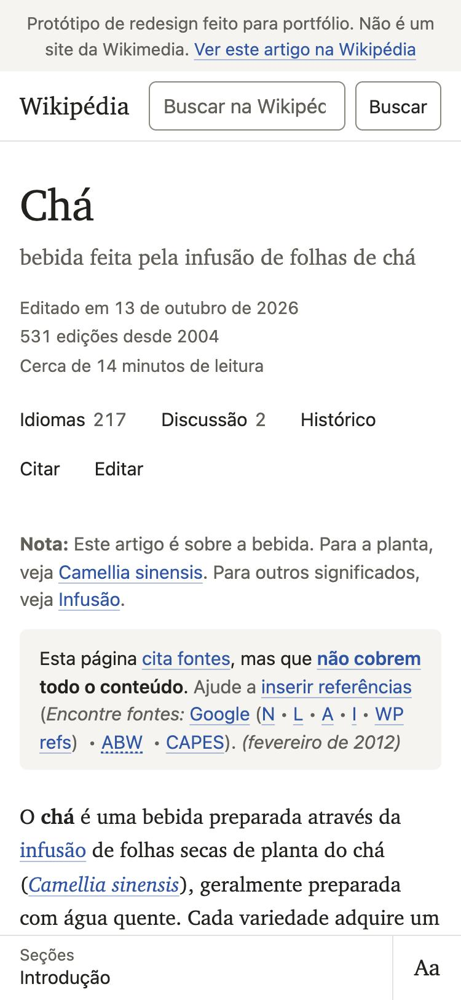
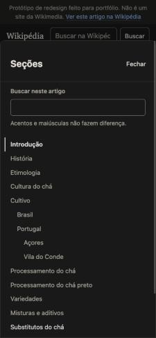

# 8. Celular, tablet e computador

Mudar o número de colunas é a parte fácil. A pergunta que guiou esta etapa foi outra: o que a pessoa está fazendo quando abre o artigo em cada aparelho, e o que precisa estar ao alcance nesse momento.

## Celular

Quem abre "Chá" no celular quase sempre veio de um buscador, procurando uma coisa: a temperatura da água para chá verde, de onde vem o nome, se chá preto tem cafeína. A leitura é em pé, com uma mão, e interrompida.

O que importa, então, é chegar rápido ao trecho certo e conseguir voltar depois. Por isso:

- A primeira tela mostra o título, a descrição curta, os metadados, as ferramentas, a nota de desambiguação, o aviso de fontes e o começo do texto. A ficha vem depois do primeiro parágrafo.
- A barra inferior fica ao alcance do polegar e mostra a seção atual. Tocar nela abre o sumário com a busca em cima.
- As seções não ficam recolhidas. O sumário faz o papel de visão geral (ver [D05](registro-de-decisoes.md)).
- A retomada de leitura serve à leitura interrompida: "Você parou em Preparação".
- Os painéis sobem da base da tela, onde o polegar alcança o botão Fechar e o conteúdo.
- A opção de largura da coluna não aparece, porque a coluna já ocupa a tela.

Considerei colocar a seção atual no topo da tela, como no tablet. Ficou embaixo por alcance: no topo, num celular de 6 polegadas, o polegar não chega sem trocar a pegada.

## Tablet

O tablet é o aparelho da leitura longa e relaxada: no sofá, na cama, com o aparelho apoiado. Aqui a tipografia e as opções de leitura pesam mais que a navegação.

Em pé (768 px), a página tem uma coluna centralizada com margens largas. A barra do topo fica fixa e mostra a seção atual; tocar nela abre o sumário pela esquerda. Os painéis abrem pela direita e deixam parte do texto visível. Doar e Entrar descem para o rodapé para dar espaço à seção atual na barra.

Deitado (a partir de 1024 px), o sumário lateral aparece fixo, como no computador.

## Computador

O computador é onde se pesquisa: várias abas, anotações, citação. O leitor alterna entre ler e consultar.

- O sumário e a busca ficam sempre visíveis à esquerda.
- A partir de 1248 px, a ficha e as figuras vão para a margem direita, ao lado do parágrafo em que foram colocadas, e a coluna de texto fica livre.
- Os painéis abrem na lateral direita sem bloquear o texto. Dá para ler a seção Preparação com o histórico aberto ao lado.
- A prévia de referência abre ao lado da chamada, sem tirar o leitor do lugar.
- A barra do topo fica fixa com a busca da Wikipédia e as opções de leitura.

## O que não muda entre aparelhos

O texto, a ordem das seções, os avisos e as ferramentas disponíveis. Nenhuma funcionalidade existe só no computador ou só no celular; muda onde ela fica.
