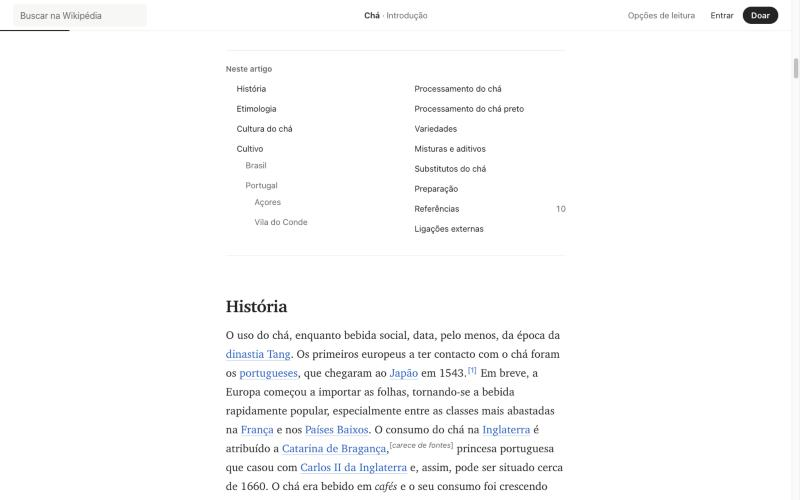

# 11. Versão 2: a Wikipédia como publicação

A versão 1 (tag `v1-notion` no repositório) manteve a estrutura de um artigo de enciclopédia: sumário fixo à esquerda, texto no meio e ficha e figuras numa coluna à direita. O acabamento era de Notion e Linear. A versão 2 muda a estrutura. O pedido foi tratar o redesign como um rebranding, com referência em Medium e Substack: uma coluna única, tipografia editorial, uma abertura com imagem e um cabeçalho que diz quem escreveu e quanto leva para ler.

O texto do artigo continua o mesmo, na mesma ordem. Mudou onde cada peça de interface fica e o que a página mostra primeiro.

## O que mudou

| | Versão 1 | Versão 2 |
| --- | --- | --- |
| Estrutura | Três colunas: sumário, texto, margem | Uma coluna centralizada de cerca de 610 px, com a abertura um pouco mais larga |
| Sumário | Lateral fixo, sempre visível | Bloco "Neste artigo" no texto, logo depois da introdução, e painel "Seções e busca" |
| Seção atual | Marcada no sumário lateral | Na barra do topo, que troca a marca pelo título e a seção ao rolar |
| Ficha | Na margem direita, com a imagem | Bloco na coluna, depois do primeiro parágrafo, sem a imagem |
| Imagem principal | Dentro da ficha | Abertura do artigo, entre o cabeçalho e o texto |
| Figuras | Na margem, com 16rem | Na coluna, centralizadas, sem passar do tamanho do arquivo |
| Cabeçalho | Título, descrição, metadados, ferramentas em botões com contorno | Título grande, descrição, autoria, tempo de leitura, ferramentas numa barra de texto entre duas linhas |
| Fonte padrão | Sans do sistema | Serifada do sistema (Charter) |
| Marca | "Wikipédia" em serifa regular | "Wikipédia" em serifa negrito, com espaçamento fechado |
| Doar | Link de texto | Botão preto em pílula, a única superfície cheia da página |
| Progresso | Nenhum | Linha de 2 px sob a barra do topo |

## O cabeçalho do artigo

Do topo para baixo: o título em serifa negrito a até 72 px, a descrição curta do Wikidata em cinza, uma linha de autoria e uma de tempo de leitura e data, e as ferramentas.

A linha de autoria diz "Escrito por 289 colaboradores em 531 edições desde 2004". Os 289 incluem 177 contas e 112 endereços IP, e o link leva ao histórico. Medium e Substack mostram um nome de pessoa nesse lugar. Aqui o autor é coletivo, e dizer isso com um número é a forma mais curta de explicar o que a Wikipédia é. Os números vêm da API da Wikipédia (ver [01-auditoria.md](01-auditoria.md)).

As ferramentas ficam numa barra de texto entre duas linhas finas, como a barra de ações de uma matéria: Idiomas, Discussão, Histórico e Citar à esquerda, "Seções e busca" e Editar à direita. Sem contorno, sem ícone. O contorno da versão 1 dava a cada botão o mesmo peso de um campo de formulário; sem ele a barra se lê como parte do cabeçalho. No celular "Seções e busca" some da barra, porque a barra inferior faz o mesmo papel.

## A imagem de abertura

A imagem principal da ficha (a xícara de Earl Grey) sai da ficha e abre o artigo, na largura da coluna mais 35% no computador, em proporção 16:9. Em telas pequenas, na largura da tela e em 3:2. A legenda fica centralizada embaixo.

Duas decisões de honestidade:

- A foto é recortada na apresentação com `object-fit: cover`. A imagem inteira continua no arquivo da Wikimedia, e o link da imagem leva à página dele. O recorte é de apresentação, igual ao de qualquer revista.
- A mesma imagem não aparece duas vezes. Ela deixou a ficha, em vez de ser copiada para o cabeçalho. A ficha ficou só com o título e a tabela.

O build pede ao servidor da Wikimedia as larguras de 330, 500 e 960 px, e o navegador escolhe pela largura da tela e pela densidade. A imagem de abertura é a única que carrega imediatamente (`fetchpriority="high"`); as outras carregam quando se aproximam.

## O sumário

Foi a decisão mais cara da versão 2. Tirar o sumário lateral é tirar a resposta mais direta para "onde estou?" (problema P3 da auditoria). O que a substitui:

1. **A barra do topo.** Enquanto o título está à vista, ela mostra a marca. Depois que o título sai da tela, o centro da barra mostra "Chá · Cultivo › Portugal › Açores". Tocar nele abre o painel de seções.
2. **A linha de progresso.** Uma linha de 2 px sob a barra cresce com a rolagem, calculada sobre o texto do artigo e não sobre a página inteira.
3. **"Neste artigo".** O mesmo sumário, em duas colunas, no texto, logo depois da introdução. É o lugar onde o índice de um livro estaria. Funciona sem JavaScript.
4. **"Seções e busca".** Um painel lateral com a busca no artigo e a lista de seções, aberto pelo botão da barra de ferramentas, pelo centro da barra do topo ou, no celular, pela barra inferior.

A perda existe: no computador, o leitor não vê mais o sumário inteiro enquanto lê. Quem lê uma seção e quer saltar para outra precisa abrir o painel, um toque a mais do que na versão 1. Em troca, a coluna de texto ganha o centro da tela, que é o que o pedido pedia. Registrei como D21 e marquei como a primeira coisa a testar com leitores (ver [10-limitacoes.md](10-limitacoes.md)).

## A marca

A versão 2 tem uma marca própria: "Wikipédia" em serifa negrito (Charter ou a serifada do sistema), 24 px, espaçamento de -0,03em, sem globo e sem logotipo. É um conceito de rebranding e usa só o nome. A página avisa no topo e no rodapé que não é um site da Wikimedia.

O único elemento de interface com fundo cheio é o botão "Doar", preto com texto branco (invertido no tema escuro), em pílula. A Wikipédia vive de doações e é o único apelo da página; Medium e Substack fazem o mesmo com a assinatura. Os outros botões são texto.

O azul continua sendo a única cor, nos links e no foco do teclado. A paleta passou a neutros mais frios (#242424 no texto, #f7f7f5 nas superfícies), no lugar do marrom-acinzentado da versão 1. O azul de destaque não mudou (#1d5fc4).

## Tipografia

O corpo do texto passou para 18 px no celular e 20 px no computador, com entrelinha de 1,7 e a fonte serifada do sistema. A coluna fica entre 610 e 665 px conforme a fonte, sempre com 65 ou 66 caracteres por linha (medido nas seis fontes). Isso é o que Medium e Substack fazem: texto grande, coluna estreita, muito espaço em volta.

Os títulos de seção ficam em serifa negrito a 1,55 vez o corpo. A interface (barra do topo, ferramentas, ficha, referências, painéis) continua em sans. Os motivos da separação estão em [04-tipografia-e-layout.md](04-tipografia-e-layout.md#família-tipográfica).

A fonte padrão voltou a ser serifada. Na versão 1 mudei para sans por causa de Notion e Linear; Medium e Substack são de leitura longa e usam serifa no texto. A sans do sistema continua na opção "Sem serifa", e todas as outras fontes continuam como estavam.

## O que ficou igual

Todas as funcionalidades da [versão 1](06-funcionalidades.md): busca com resultados por seção, prévia de referência, retomada de leitura, índice da ficha, idiomas, histórico, discussão, citação e as opções de leitura. O aviso "Você parou em..." passou para o topo do artigo, acima do título, em formato de nota. Nenhum texto do artigo mudou.

## Verificação

Axe-core 4.10.2 com as regras WCAG 2.0, 2.1 e 2.2 A e AA: 0 violações nos temas claro, papel e escuro, nos cinco painéis e no painel de seções, exceto 2 avisos de código de idioma ("isv" e "tok", usados pela Wikimedia e fora da lista do axe) no painel de idiomas. Todos os pares de cor passam (tabela em [05-sistema-visual.md](05-sistema-visual.md#contraste-medido)). Peso: 25,1 KB de HTML, 8,4 KB de CSS e 12,0 KB de JavaScript, comprimidos, sem nenhuma fonte baixada por padrão.

Bug encontrado no caminho, que existia desde a versão 1: para fotos pequenas, o endereço da versão em tamanho original apontava para o servidor de miniaturas da Wikimedia, e o navegador mostrava uma imagem quebrada ao escolher essa versão. Apareceu quando as figuras passaram a ocupar a coluna inteira e o navegador começou a pedi-la. Corrigido no build.

## O que não foi testado

Os mesmos pontos de [09-desempenho-e-testes.md](09-desempenho-e-testes.md#o-que-não-foi-testado) e mais dois: a imagem de abertura num artigo sem imagem na ficha (o cabeçalho então não tem abertura, e isso não foi desenhado nem testado) e artigos com ficha de várias imagens.
