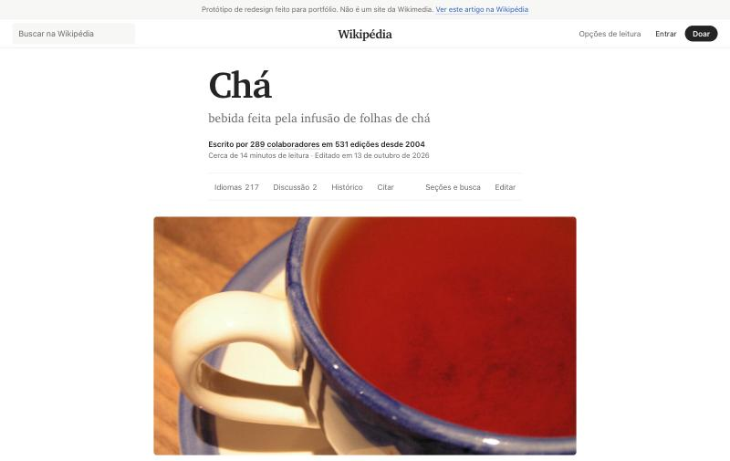

# Redesign de leitura da Wikipédia: o artigo Chá

Redesign conceitual da página de artigo da Wikipédia, na versão 2 com estrutura de publicação (Medium e Substack), demonstrado com o artigo [Chá](https://pt.wikipedia.org/wiki/Ch%C3%A1) da Wikipédia em português. O foco é orientação e leitura: encontrar a informação dentro de um artigo longo, ler com conforto por muito tempo e usar as ferramentas que a Wikipédia já tem sem que elas fiquem escondidas. O texto do artigo não foi resumido, encurtado nem reescrito.

## Documentos, na ordem do processo

1. [Auditoria do artigo atual](01-auditoria.md): o que o Vector 2022 resolveu, o que não resolveu, com medições. Termina com a lista de problemas P1 a P8, citada nos outros documentos.
2. [Tese e princípios](02-tese-e-principios.md): a biblioteca que não encurta os livros, e nove regras verificáveis.
3. [Arquitetura de informação](03-arquitetura-de-informacao.md): quatro camadas de navegação, estrutura da página e de onde veio cada item do Vector.
4. [Tipografia e layout](04-tipografia-e-layout.md): medida da linha, famílias, escala, grade e a lista do que o build faz com o HTML do artigo.
5. [Sistema visual](05-sistema-visual.md): tokens de cor, tipo e espaço, tabela de contraste e componentes.
6. [Funcionalidades](06-funcionalidades.md): seções, busca, referências, retomada, ficha, idiomas, histórico, discussão, citar, opções de leitura e avisos.
7. [Acessibilidade](07-acessibilidade.md): estrutura, teclado, leitores de tela, movimento e como foi verificado.
8. [Celular, tablet e computador](08-responsivo.md): o que cada contexto de leitura pede.
9. [Desempenho e testes](09-desempenho-e-testes.md): peso, testes feitos, erros encontrados e o que não foi testado.
10. [Limitações](10-limitacoes.md): o que o conceito não cobre e o que faltou verificar.
11. [Versão 2: a Wikipédia como publicação](11-versao-2-editorial.md): a mudança de estrutura no formato de Medium e Substack. A versão 1 está na tag `v1-notion`.

O [registro de decisões](registro-de-decisoes.md) reúne as 24 decisões principais no formato problema, alternativas, escolha e motivo.

## Em números

| | Página atual (Vector 2022) | Redesign |
| --- | --- | --- |
| Caracteres por linha no computador | 64 a 121 no mesmo artigo | 65 (opções de 55 e 75), em qualquer das seis fontes |
| Peso na primeira visita, sem imagens | cerca de 232 KB, 37 requisições | 45,5 KB, 3 requisições |
| Citar | dentro de um menu de 18 itens | no cabeçalho, 6 formatos, data de acesso correta |
| Sumário no celular | não há | barra inferior com a seção atual e painel de seções |
| Violações automáticas de WCAG 2.2 AA (axe) | não medido | 0 nos três temas |

## Créditos

Texto, ficha e referências: artigo [Chá](https://pt.wikipedia.org/w/index.php?title=Ch%C3%A1&oldid=73198638) da Wikipédia em português, revisão 73198638, pelos [colaboradores da Wikipédia](https://pt.wikipedia.org/w/index.php?title=Ch%C3%A1&action=history), sob [CC BY-SA 4.0](https://creativecommons.org/licenses/by-sa/4.0/deed.pt-br). As imagens vêm do Wikimedia Commons, cada uma com sua licença na página do arquivo. Fontes opcionais Inter, Literata, Source Serif 4 e Atkinson Hyperlegible Next, todas sob a SIL Open Font License.

As capturas de tela da página atual da Wikipédia (arquivos `imagens/auditoria-*.jpg`) foram feitas em 15 de outubro de 2026 para fins de análise.

Este é um projeto de portfólio sem relação com a Wikimedia Foundation.
